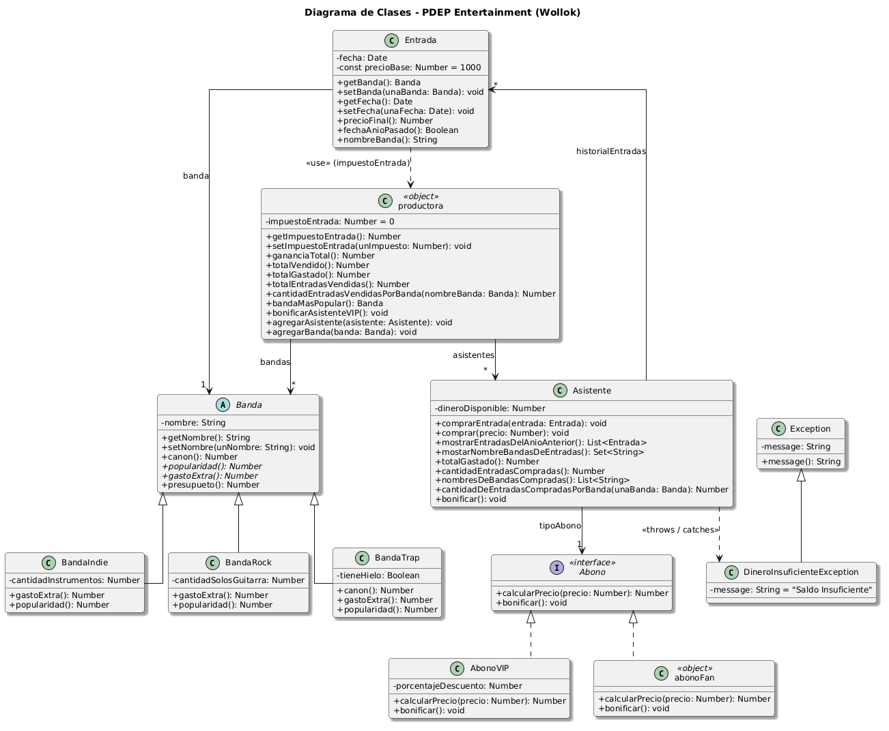

# Conceptos Vistos en la Materia

A continuación se detallan los conceptos principales de Diseño Orientado a Objetos que fueron aplicados en la resolución de este proyecto.

---

## Polimorfismo

Se utiliza en la jerarquía de **Abonos** para la vista del `Asistente`, más específicamente en los métodos:
* `calcularPrecio()`
* `bonificar()`

Tanto el objeto `AbonoFan` como cualquier instancia de `AbonoVIP` entienden estos dos mensajes, actuando de manera diferente y transparente para quien los invoca.

## Composición

Se aplica en la clase `Asistente` respecto a su tipo de **Abono**. En vez de tener una clase distinta por cada tipo de abono de asistente, se delega esta responsabilidad a un atributo interno. Esto permite cambiar de tipo de abono en tiempo de ejecución, de forma dinámica y sin necesidad de reinstanciar al asistente.

## Herencia

Se emplea en la clase `Banda`. Esta superclase simplifica los atributos y comportamientos comunes de las bandas en general, centralizando el código repetido y declarando algunos métodos abstractos que obligan a las subclases a definir su propio comportamiento.

## Encapsulamiento

Se evidencia fuertemente en el manejo del historial de entradas del `Asistente`. El objeto expone consultas de negocio específicas, como el método `cantidadEntradasCompradas()`, en vez de devolver la lista directa de entradas para que terceros la manipulen libremente rompiendo el encapsulamiento.

## Asignación de Responsabilidades

Se refleja en la correcta separación de responsabilidades dentro del modelo, logrando clases cohesivas. Por ejemplo:

* **Entrada**: Sabe su fecha, conoce a qué banda corresponde y es la única responsable de calcular su propio precio incluyendo impuestos.
* **Asistente**: Gestiona su billetera, registra las compras realizadas y es capaz de responder sobre sus propios gastos.

---

## Diagrama de Clases

